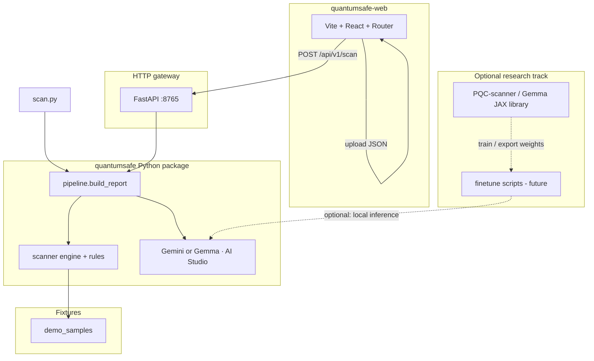

# QuantumSafe platform architecture

This monorepo is structured so **one scan pipeline** powers the CLI, HTTP API, and UI. Optional **research** (Gemma / JAX) lives beside it, not inside the hot path.

## System diagram



## Folders

| Path | Role |
|------|------|
| **`quantumsafe/`** | Core product: **scanner**, **pipeline**, **AI client**, **FastAPI app** (`api_app.py`). Single source of truth for “what is a report”. |
| **`scan.py`** | Thin **CLI**; calls `quantumsafe.pipeline.build_report` (same as the API). |
| **`quantumsafe-web/`** | **UI**: import JSON, or call the gateway for a live scan of a path under `QUANTUM_ROOT`. |
| **`demo_samples/`** | **Golden fixtures** for demos, tests, and the “Scan demo_samples via API” button. |
| **`PQC-scanner/`** | **Upstream Gemma library** (JAX/Flax). Use for **fine-tuning / research**, not required for `scan.py` or the gateway. Keeps ML experimentation separate from shipping scanner logic. |
| **`requirements-quantumsafe.txt`** | Python dependencies for CLI + API + Gemini. |

## Contracts

- **Report JSON**: `scan_summary`, `findings[]`, `migration_plan` — shared by CLI file output, API response, and web app state.
- **`QUANTUM_ROOT`**: Absolute path to the monorepo root (default: auto). The API only allows scanning **child paths** of this root (no `..` traversal).

## Runbooks

**CLI (offline or + Gemini):**

```bash
python scan.py --dir demo_samples -o report.json
python scan.py --dir demo_samples --api-mode -o report.json
```

**Gateway + UI (connected stack):**

```bash
# Terminal 1 — from monorepo root
pip install -r requirements-quantumsafe.txt
uvicorn quantumsafe.api_app:app --host 127.0.0.1 --port 8765

# Terminal 2
cd quantumsafe-web && npm run dev
```

Open the Scan page → **Scan demo_samples via API** (proxies `/api` → port 8765).

**Production / custom API URL:** set `VITE_API_BASE` in the web app to your gateway origin.

## Evolution (pioneer product)

1. **Now**: Deterministic discovery + optional cloud LLM assessment + unified report.
2. **Next**: Zip/upload scan in API, SARIF export, CI GitHub Action calling the same `build_report`.
3. **Research**: Fine-tune Gemma with the code in `PQC-scanner/` (JAX), export weights or adapters, then optionally wire a **local** inference backend into `pipeline` later.

### LLM assessment (Gemini vs Gemma via AI Studio)

- **One client**: `google-generativeai` + `GOOGLE_API_KEY` / `GOOGLE_AI_API_KEY`.
- **Model id**: pass `model` on `POST /api/v1/scan` or `--model` on `scan.py`. Examples: `gemini-2.0-flash`, `gemma-2-9b-it` (exact IDs depend on your Studio account).
- **Prompt selection**: if the model id contains `gemma`, the service loads `quantumsafe/prompts/gemma_pqc.txt` (PQC-focused JSON + optional `executive_summary`); otherwise `system_api.txt`.
- **Deep context**: `deep_context` / `--deep` sends bounded **line context** around each hit so Gemma/Gemini can justify patches using real code, not only rule metadata.

The **`PQC-scanner/`** tree is still the **research** Gemma/JAX codebase — not required for HTTP scans. Production today uses **Google-hosted** Gemma/Gemini through the API.

This keeps **shipping path** (scanner + API + UI) independent of **lab path** (JAX Gemma source).
